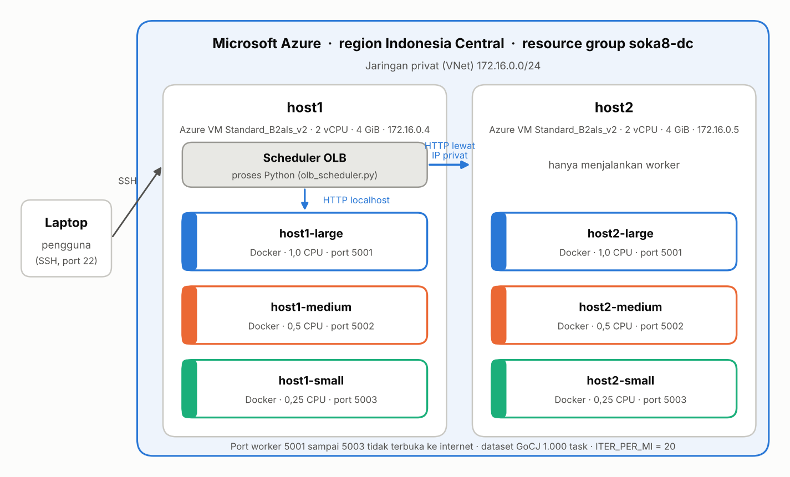
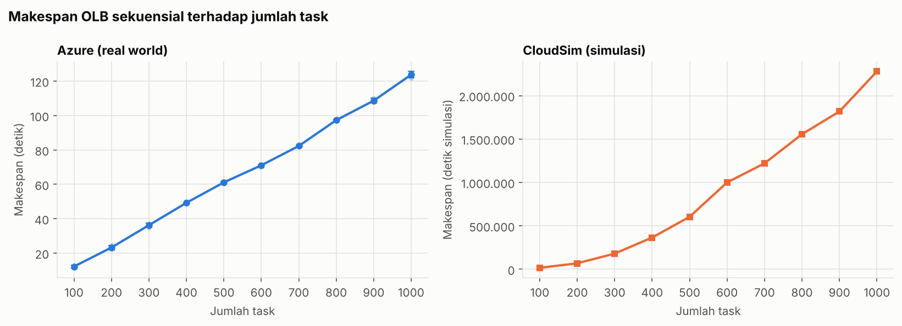
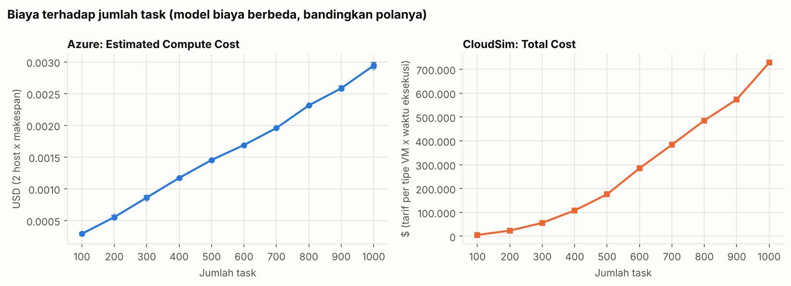
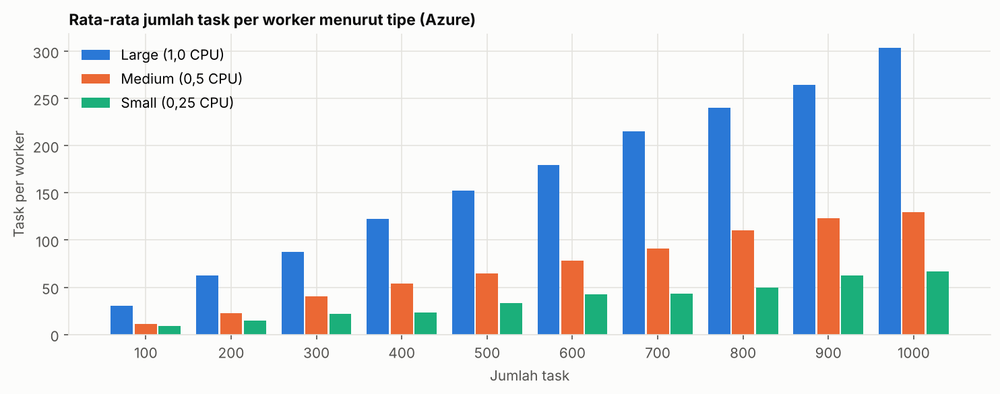
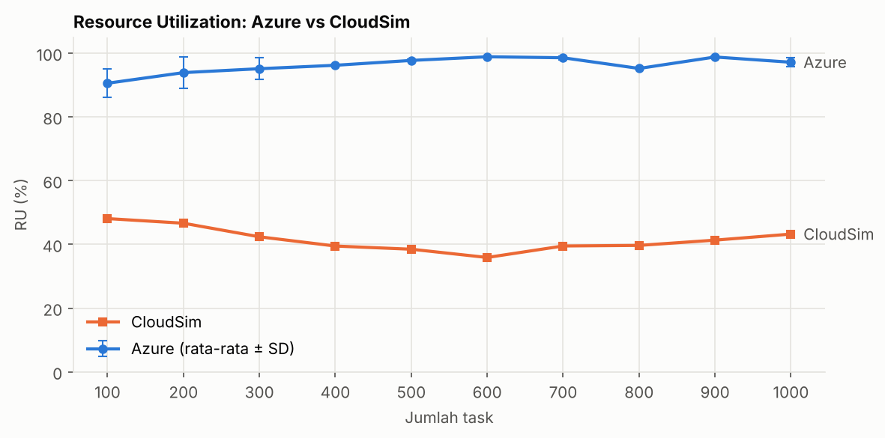
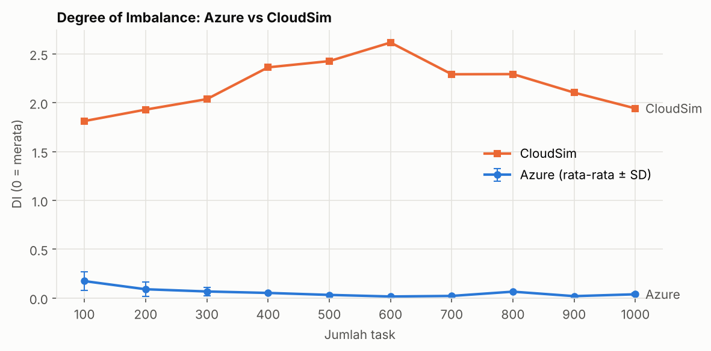
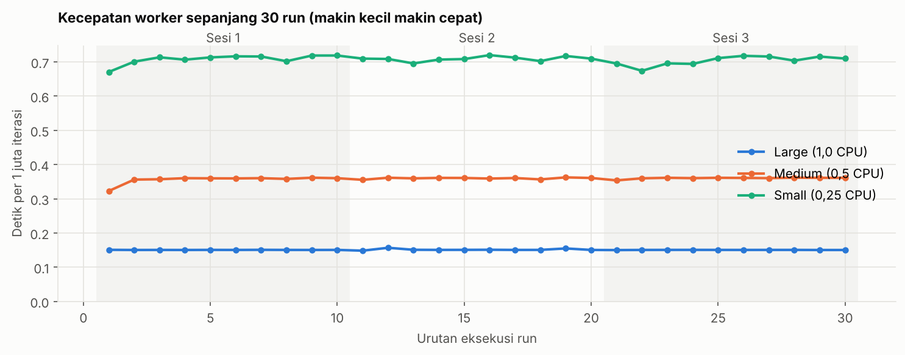
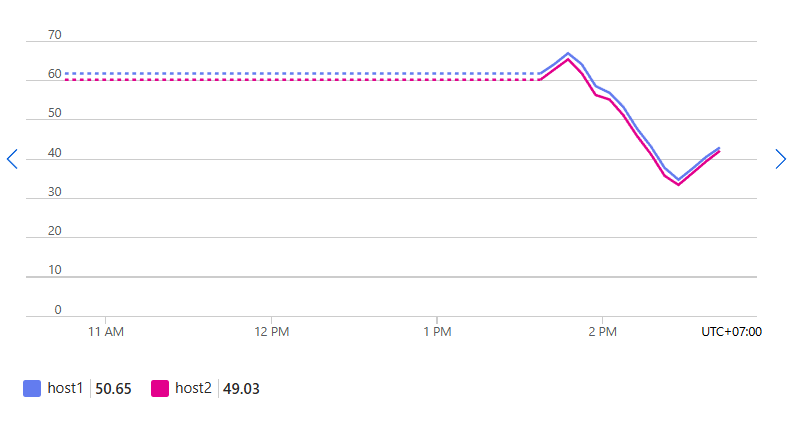

<h1 align="center">Implementasi Real-World OLB di Microsoft Azure</h1>
<h3 align="center">Strategi Optimasi Komputasi Awan (SOKA) 2026 · Kelompok 8</h3>

<p align="center">
  
  
  
  
  
  
  
</p>

---

## Anggota Kelompok 8

| No. | Nama | NRP |
| :---: | :--- | :---: |
| 1 | Dimas Muhammad Putra | 5027241076 |
| 2 | Syifa Nurul Alfiah | 5027241019 |
| 3 | Hafiz Ramadhan | 5027241096 |
| 4 | Muhammad Ahsani Taqwiim Rakhman | 5027241099 |
| 5 | Evan Christian Nainggolan | 5027241026 |

---

## Daftar Isi

1. [Ringkasan](#1-ringkasan)
2. [Daftar istilah](#2-daftar-istilah)
3. [Pemetaan ke syarat tugas](#3-pemetaan-ke-syarat-tugas)
4. [Environment, arsitektur, dan alasan memakai Docker](#4-environment-dan-arsitektur)
5. [Cara kerja OLB](#5-cara-kerja-olb)
6. [Dataset GoCJ dan faktor ITER_PER_MI](#6-dataset-gocj-dan-faktor-iter_per_mi)
7. [Metode pengujian](#7-metode-pengujian)
8. [Empat metrik evaluasi](#8-empat-metrik-evaluasi)
9. [Hasil pengujian di Azure](#9-hasil-pengujian-di-azure)
10. [Perbandingan dengan CloudSim](#10-perbandingan-dengan-cloudsim)
11. [Kestabilan pengukuran dan CPU credits](#11-kestabilan-pengukuran-dan-cpu-credits)
12. [Kesimpulan](#12-kesimpulan)
13. [Keterbatasan](#13-keterbatasan)
14. [Menjalankan program](#14-menjalankan-program)
15. [Struktur folder](#15-struktur-folder)
16. [Referensi](#16-referensi)

---

## 1. Ringkasan

Di repository CloudSim kelompok kami, algoritma **Opportunistic Load Balancing (OLB)** diuji di
**simulator**: durasi task hanya *dihitung* dari panjang task (MI) dibagi kecepatan VM (MIPS).
Di folder ini, OLB dijalankan di **cloud nyata**, yaitu Microsoft Azure. Task benar-benar dikirim
lewat jaringan, dikerjakan CPU, lalu waktunya diukur.

Pengujian utama: **sekuensial 100 sampai 1.000 task, masing-masing 3 run (30 run)**, dijalankan
pada 31 Oktober 2026. Semua 30 run lolos validasi otomatis.

**Temuan utama:**
- **Makespan naik sebanding dengan total beban.** Dari 12,19 detik (100 task) sampai 123,75 detik
  (1.000 task), konsisten sekitar 1 detik per 1 juta MI.
- **Worker hampir tidak pernah menganggur.** Resource Utilization 90,6 sampai 98,9%, dan Degree of
  Imbalance hanya 0,02 sampai 0,17. Ini berbeda jauh dari CloudSim (RU 36 sampai 48%, DI 1,8 sampai 2,6).
- **Sifat OLB tetap terlihat.** OLB tidak melihat kecepatan worker, tetapi worker cepat lebih sering
  kosong, sehingga otomatis mendapat lebih banyak task. Pada 1.000 task, satu worker Large rata-rata
  mengerjakan 304 task, Medium 130, dan Small 67.
- **Hasil real world tidak identik antar-run** walaupun inputnya sama, berbeda dengan CloudSim yang
  deterministik. Variasinya kecil: simpangan baku makespan di bawah 2% untuk 400 task ke atas.
- **CPU credits Azure tidak habis** selama pengujian, dan kecepatan worker stabil di seluruh 30 run.

## 2. Daftar istilah

| Istilah | Arti sederhana |
| :--- | :--- |
| **Task** | Satu pekerjaan dari dataset GoCJ. Ukurannya dalam **MI** (juta instruksi). |
| **Host** | Mesin yang menampung beberapa worker. Di sini wujudnya **Azure VM** (`host1`, `host2`). |
| **Worker** | "VM" versi proyek ini: **Docker container** dengan batas CPU tertentu. Representasi logis VM CloudSim, bukan VM sungguhan. |
| **Scheduler** | Program Python di host1 yang membagi task ke worker dengan aturan OLB. |
| **OLB** | Opportunistic Load Balancing: task diberikan ke worker yang sedang kosong, tanpa melihat kecepatan worker atau ukuran task. |
| **Makespan** | Waktu dari awal sampai task **terakhir** selesai. Makin kecil makin baik. |
| **Run** | Satu kali pengujian dengan sejumlah task tertentu. |
| **Sesi** | Sekelompok run yang dijalankan dalam satu waktu. 30 run dibagi menjadi 3 sesi. |
| **CPU credits** | "Saldo" CPU pada Azure VM seri B. Kalau habis, CPU VM dibatasi ke 30%. |

## 3. Pemetaan ke syarat tugas

| Syarat | Yang kami buat | Berkas |
| :--- | :--- | :--- |
| Platform cloud nyata | Microsoft Azure (Azure for Students), region Indonesia Central | [PENCERDASAN.md](PENCERDASAN.md) |
| Datacenter | Seluruh resource di region Indonesia Central, dikelompokkan di resource group `soka8-dc` | [PENCERDASAN.md](PENCERDASAN.md) bagian B |
| Minimal 2 host | 2 Azure VM `Standard_B2als_v2`: `host1` dan `host2` | [PENCERDASAN.md](PENCERDASAN.md) bagian B4, B5 |
| Minimal 2 VM per host | 3 worker (Docker container) per host: Large, Medium, Small | [worker/start_host.sh](worker/start_host.sh) |
| Algoritma heuristik dari CloudSim | OLB dengan aturan yang sama: worker yang paling awal siap | [scheduler/olb_scheduler.py](scheduler/olb_scheduler.py) |
| Dataset | GoCJ 1.000 task, sama dengan CloudSim | [scheduler/dataset/](scheduler/dataset/) |
| Evaluasi dan perbandingan | 30 run, 4 metrik, perbandingan dengan CloudSim, 6 grafik | Bagian 9 dan 10, [grafik/](grafik/) |

## 4. Environment dan arsitektur

### 4.1 Environment

| Komponen | Spesifikasi |
| :--- | :--- |
| Cloud provider | Microsoft Azure (langganan Azure for Students) |
| Region | Indonesia Central (Jakarta) |
| Resource group | `soka8-dc` (pengelompokan logis, bukan datacenter fisik) |
| Jaringan | VNet `vnet-indonesiacentral-1`, subnet `172.16.0.0/24` (privat) |
| Host | 2 x Azure VM `Standard_B2als_v2`: 2 vCPU, 4 GiB RAM, burstable (performa dasar 30%) |
| Sistem operasi host | Ubuntu Server 24.04 LTS |
| Worker | Docker container dari image `python:3.12-slim`, 3 per host |
| Scheduler | Python 3 di host1, hanya memakai library bawaan |
| Tarif yang diasumsikan | $0,0428 per jam per Azure VM (estimasi Azure Portal saat VM dibuat) |
| Akses dari luar | Hanya SSH (22). Port worker 5001 sampai 5003 hanya bisa diakses dari jaringan privat |

### 4.2 Arsitektur



Cara membaca gambar:
- **Kotak biru besar** adalah Azure. Semua yang ada di dalamnya berjalan di cloud, di jaringan privat yang sama.
- **host1 dan host2** adalah dua Azure VM. Keduanya punya spesifikasi yang sama.
- **Kotak berwarna** di dalam host adalah worker (Docker container). Warnanya menunjukkan tipe:
  biru = Large, oranye = Medium, hijau = Small.
- **Scheduler OLB** hanya ada di host1. Ia menghubungi worker host1 lewat `localhost` (komputer yang
  sama) dan worker host2 lewat IP privat Azure (panah biru).
- **Laptop** hanya dipakai untuk masuk ke host1 lewat SSH. Pengujian berjalan sepenuhnya di Azure.

Versi teks (sama isinya):

```
Microsoft Azure, region Indonesia Central, resource group soka8-dc
 |  jaringan privat 172.16.0.0/24
 |
 |-- Azure VM host1 (B2als_v2: 2 vCPU, 4 GiB)            private IP 172.16.0.4
 |     |-- worker host1-large   (Docker, batas 1,0 CPU)   port 5001
 |     |-- worker host1-medium  (Docker, batas 0,5 CPU)   port 5002
 |     |-- worker host1-small   (Docker, batas 0,25 CPU)  port 5003
 |     '-- scheduler OLB (olb_scheduler.py)
 |              |  HTTP: localhost (host1) dan IP privat (host2)
 '-- Azure VM host2 (B2als_v2: 2 vCPU, 4 GiB)            private IP 172.16.0.5
       |-- worker host2-large   (Docker, batas 1,0 CPU)   port 5001
       |-- worker host2-medium  (Docker, batas 0,5 CPU)   port 5002
       '-- worker host2-small   (Docker, batas 0,25 CPU)  port 5003
```

Scheduler berjalan di host1 bersama tiga worker. Total batas CPU worker di host1 adalah 1,75 dari
2 vCPU, sehingga masih ada sisa untuk scheduler. Scheduler sebagian besar hanya menunggu balasan,
tetapi tetap ikut memakai resource host1, jadi ini dicatat sebagai batasan eksperimen.

### 4.3 Kenapa memakai Docker container sebagai "VM"?

Tugas meminta struktur **datacenter, host, dan VM** seperti di CloudSim. Di Azure, kita hanya bisa
menyewa VM. Kita tidak bisa memilih atau melihat server fisik tempat VM itu berjalan, jadi lapisan
"host" tidak bisa ditunjukkan kalau Azure VM langsung dijadikan "VM".

Solusinya:
1. **Azure VM dijadikan host.** Kita punya kendali penuh atasnya: bisa masuk, memasang program, dan
   menjalankan beberapa "mesin" di dalamnya.
2. **Docker container dijadikan VM.** Container adalah lingkungan terpisah yang ringan di dalam satu
   host. Setiap container punya program dan alamat (port) sendiri, seperti VM kecil.
3. **Kecepatan diatur lewat jatah CPU.** Docker bisa membatasi CPU tiap container (`--cpus 1.0`, `0.5`,
   `0.25`). Ini pengganti MIPS di CloudSim: container dengan jatah 1,0 CPU kira-kira 4 kali lebih cepat
   daripada yang 0,25 CPU.

Alasan lain memilih Docker:
- **Hemat biaya.** Enam VM Azure sungguhan jauh lebih mahal daripada dua VM berisi enam container.
- **Mudah diulang.** Semua worker dibuat dari satu resep (`worker/Dockerfile`). Satu perintah
  (`start_host.sh`) menyalakan tiga worker yang identik kecuali jatah CPU-nya.
- **Bisa dicoba di laptop.** Resep yang sama dipakai `docker-compose.yml` untuk uji coba gratis di laptop
  sebelum memakai Azure.

Konsekuensinya, container **bukan** VM penuh: ia berbagi sistem operasi dengan host. Ini dicatat di
bagian keterbatasan.

### 4.4 Pemetaan dari CloudSim

| CloudSim | Real world (proyek ini) |
| :--- | :--- |
| Datacenter | Region Azure Indonesia Central + resource group `soka8-dc` (tidak ada padanan fisik pasti) |
| Host (4 host: 2 High Performance, 2 Standard) | Azure VM (2 host, spesifikasi sama) |
| VM (10 VM: 2 Large 2x1.000 MIPS, 4 Medium 1.000 MIPS, 4 Small 500 MIPS) | Worker (6 container: 2 Large 1,0 CPU, 2 Medium 0,5 CPU, 2 Small 0,25 CPU) |
| MIPS | Batas CPU Docker (`--cpus`) |
| Cloudlet (panjang MI) | Task GoCJ yang dijalankan sebagai beban CPU sintetis |
| Durasi task = `length / MIPS` (dihitung) | Durasi task = waktu nyata menjalankan loop (diukur) |
| `applyOlbScheduling()` | `run_olb()` di `scheduler/olb_scheduler.py` |

Jumlah dan kecepatan VM tidak sama dengan CloudSim. Karena itu yang dibandingkan adalah **pola**,
bukan angka absolut.

## 5. Cara kerja OLB

1. Scheduler membaca task dari dataset GoCJ.
2. Scheduler memeriksa worker mana yang sedang idle.
3. Task dikirim ke worker idle. Kalau ada beberapa yang idle, dipilih yang paling awal siap,
   lalu urutan daftar worker sebagai pemecah seri. Kalau semua sibuk, scheduler menunggu.
4. Worker menjalankan beban CPU sebanding panjang task.
5. Worker mengembalikan hasil dan waktu eksekusi.
6. Scheduler mencatat hasil dan menandai worker tersebut tersedia kembali.
7. Langkah 2 sampai 6 diulang sampai seluruh task selesai.

Satu worker hanya mengerjakan satu task pada satu waktu.

**Bedanya dengan CloudSim.** CloudSim membagi semua task **di awal** berdasarkan ready time yang
dimodelkan (`readyTime += length / MIPS`). Versi real world membagi task **satu per satu**, saat worker
benar-benar selesai dan responsnya diterima scheduler. Aturan pemilihannya sama, mekanismenya berbeda.
Penjelasan kode ada di [PENCERDASAN2.md](PENCERDASAN2.md).

## 6. Dataset GoCJ dan faktor ITER_PER_MI

Dataset: `GoCJ_Dataset_1000.csv`, 1.000 task, panjang 15.000 sampai 900.000 MI.

CloudSim memakai MI untuk **menghitung** durasi. Di cloud nyata kita harus **menjalankan** sesuatu,
padahal GoCJ tidak menyediakan kode asli tiap pekerjaan. Jadi panjang task dipakai sebagai bobot
beban CPU sintetis: **setiap 1 MI = 20 iterasi** fungsi `burn_cpu()`.

- Contoh: task 83.000 MI dikerjakan dengan 83.000 x 20 = 1.660.000 iterasi.
- Perbandingan berat antartask tetap sama dengan dataset.
- Satu iterasi Python bukan satu instruksi mesin, jadi waktu Azure **tidak bisa dibandingkan langsung**
  dengan waktu CloudSim.
- Nilai 20 dipakai sejak pengujian pertama supaya konsisten. Nilai ini belum dikalibrasi.
- Scheduler memastikan keenam worker memakai nilai 20 sebelum pengujian dimulai.

## 7. Metode pengujian

- **Mode sekuensial**: N task = N baris pertama dataset. Ketiga run untuk ukuran yang sama memakai
  input dan urutan yang identik.
- **Ukuran**: 100, 200, 300, 400, 500, 600, 700, 800, 900, 1.000 task, masing-masing **3 run**: total 30 run.
- **Dibagi 3 sesi** supaya CPU credits Azure sempat terisi di antara sesi:

| Sesi | Isi | Waktu mulai (WIB) |
| :---: | :--- | :---: |
| 1 | Run 1 untuk 100 sampai 1.000 task | 13.47 |
| 2 | Run 2 untuk 100 sampai 1.000 task | 14.01 |
| 3 | Run 3 untuk 100 sampai 1.000 task | 14.13 |

- Setiap run divalidasi otomatis sebelum disimpan: jumlah task sesuai, tidak ada task duplikat atau
  hilang, satu worker tidak mengerjakan dua task sekaligus, dan metrik bernilai wajar.
- Random sampling direncanakan sebagai tahap berikutnya dan belum dijalankan.

## 8. Empat metrik evaluasi

| Metrik | Rumus | Arti |
| :--- | :--- | :--- |
| **Makespan** (detik) | `max(finish)` | Waktu dari awal penjadwalan sampai respons task terakhir diterima scheduler, termasuk overhead jaringan |
| **Estimated Compute Cost** (USD) | `(tarif host1 + tarif host2) x makespan / 3600` | Estimasi biaya dua Azure VM selama makespan. **Bukan tagihan Azure sebenarnya** |
| **Resource Utilization** (%) | `total waktu kerja semua worker / (6 x makespan) x 100` | Seberapa sibuk worker selama makespan. Bukan `Percentage CPU` Azure |
| **Degree of Imbalance** | `(sibuk terlama - sibuk tersingkat) / rata-rata sibuk` | Seberapa timpang waktu sibuk antarworker. 0 = merata |

Tagihan Azure sebenarnya juga mencakup waktu VM menyala di luar pengujian, disk, dan IP publik.
Penjelasan lengkap tiap metrik ada di [PENCERDASAN2.md](PENCERDASAN2.md) bagian 5.

## 9. Hasil pengujian di Azure

Data lengkap: [hasil-azure/sequential/azure-seq-30run/](hasil-azure/sequential/azure-seq-30run/)
(laporan otomatis, ringkasan CSV, log tiap task, log sesi).

### 9.0 Sebelum membaca grafik

**Kenapa grafik makespan dan biaya dibuat kiri-kanan, tidak disatukan?**

Karena angka Azure dan CloudSim punya "satuan" yang tidak sebanding, walaupun sama-sama ditulis detik:

| | CloudSim | Azure |
| :--- | :--- | :--- |
| Dari mana angka detiknya | **Dihitung** oleh simulator: ukuran task (MI) dibagi kecepatan VM (MIPS) | **Diukur** dengan jam: berapa lama CPU benar-benar bekerja |
| Ukuran pekerjaan | 1 MI = 1 juta instruksi (dalam model) | 1 MI = 20 putaran loop Python (bagian 6) |
| Contoh 1.000 task | sekitar 2,3 juta detik (sekitar 26 hari simulasi) | sekitar 124 detik |
| Infrastruktur | 4 host, 10 VM | 2 host, 6 worker |
| Biaya | Tarif per tipe VM x waktu kerja cloudlet (angka contoh di kode CloudSim) | Tarif sewa 2 Azure VM ($0,0428/jam) x makespan |

Kalau digambar di satu sumbu, garis Azure (maksimal sekitar 124) akan tampak rata di dasar grafik karena
CloudSim mencapai jutaan. Jadi keduanya digambar terpisah, masing-masing dengan skalanya sendiri.
Yang dibandingkan adalah **bentuk garisnya**: naik lurus, naik melengkung, stabil, atau naik-turun.

**Kenapa RU dan DI boleh disatukan?** Karena satuannya sama: RU dalam persen (0 sampai 100) dan DI adalah
rasio tanpa satuan. Keduanya mengukur hal yang sama di kedua lingkungan, jadi bisa dibandingkan langsung
di satu grafik.

**Arti elemen grafik Azure:**
- **Garis biru** = rata-rata 3 run.
- **Titik pudar** = hasil tiap run. Makin rapat, makin stabil hasilnya.
- **Garis kecil vertikal (error bar)** = simpangan baku: seberapa jauh ketiga run berbeda.
- CloudSim tidak punya titik pudar dan error bar karena ketiga run-nya identik.

### 9.1 Rata-rata 3 run (± simpangan baku)

| Jumlah Task | Makespan (s) | Estimated Compute Cost (USD) | Resource Utilization (%) | Degree of Imbalance |
| ---: | ---: | ---: | ---: | ---: |
| 100 | 12,19 ± 0,71 | 0,000290 | 90,56 ± 4,50 | 0,1731 ± 0,0930 |
| 200 | 23,25 ± 1,27 | 0,000553 | 93,89 ± 5,03 | 0,0897 ± 0,0752 |
| 300 | 36,24 ± 1,38 | 0,000862 | 95,12 ± 3,39 | 0,0669 ± 0,0415 |
| 400 | 49,24 ± 0,12 | 0,001171 | 96,19 ± 0,19 | 0,0519 ± 0,0041 |
| 500 | 61,13 ± 0,21 | 0,001454 | 97,72 ± 0,36 | 0,0317 ± 0,0031 |
| 600 | 71,06 ± 0,17 | 0,001690 | 98,87 ± 0,13 | 0,0155 ± 0,0012 |
| 700 | 82,30 ± 0,53 | 0,001957 | 98,55 ± 0,57 | 0,0213 ± 0,0078 |
| 800 | 97,31 ± 0,31 | 0,002314 | 95,20 ± 0,22 | 0,0650 ± 0,0013 |
| 900 | 108,66 ± 1,42 | 0,002584 | 98,79 ± 0,24 | 0,0190 ± 0,0059 |
| 1000 | 123,75 ± 1,91 | 0,002943 | 97,14 ± 1,42 | 0,0381 ± 0,0152 |

Total ke-30 run: sekitar 33 menit makespan, dengan Estimated Compute Cost sekitar $0,047.

### 9.2 Makespan dan biaya



- Makespan Azure naik hampir lurus: 100 task sekitar 12 detik, 1.000 task sekitar 124 detik.
  Kenaikannya mengikuti total MI (12,0 juta MI pada 100 task dan 129,7 juta MI pada 1.000 task),
  yaitu sekitar 1 detik per 1 juta MI.
- **Cara baca:** sumbu bawah = jumlah task, sumbu kiri = detik sampai semua task selesai. Makin rendah makin baik.
- Di CloudSim garisnya **melengkung ke atas**: 10 kali lebih banyak task membuat makespan 133 kali lebih lama.
  Di Azure garisnya **lurus**: 10 kali lebih banyak task, sekitar 10 kali lebih lama. Artinya di Azure tidak
  ada antrean yang menumpuk di satu worker, karena task dibagi saat worker benar-benar kosong.



- Di Azure, biaya = tarif dua VM x makespan, sehingga grafiknya sama persis bentuknya dengan makespan.
- CloudSim memakai model biaya lain (tarif per tipe VM x waktu eksekusi tiap cloudlet), jadi nilainya
  tidak dibandingkan langsung. Keduanya sama-sama naik seiring jumlah task.

### 9.3 Pembagian task per worker



**Cara baca:** setiap kelompok batang adalah satu ukuran pengujian. Tinggi batang = rata-rata jumlah task
yang dikerjakan **satu** worker dari tipe itu (rata-rata host1 dan host2, lalu rata-rata 3 run).

OLB tidak melihat kecepatan worker. Namun worker Large menyelesaikan task lebih cepat, sehingga lebih
sering kosong dan lebih sering dipilih. Hasilnya, pada 1.000 task, satu worker Large rata-rata
mengerjakan **304 task**, Medium **130**, dan Small **67**. Perbandingannya kira-kira 4,5 : 1,9 : 1,
mendekati perbandingan batas CPU 4 : 2 : 1.

Karena worker hampir tidak pernah menganggur, **waktu sibuk** keenam worker hampir sama (DI rendah),
walaupun **jumlah task**-nya sangat berbeda.

### 9.4 Hasil historis vs hasil baru

Pengujian awal pada 26 Oktober 2026 (scheduler sebelum revisi) hanya mencakup 100 sampai 300 task.
Hasilnya konsisten dengan pengujian baru:

| Jumlah Task | Makespan 26 Okt (s) | Makespan 31 Okt (s) |
| ---: | ---: | ---: |
| 100 | 13,51 | 12,19 |
| 200 | 22,29 | 23,25 |
| 300 | 37,87 | 36,24 |

Data historis: [hasil-azure/HASIL_REALWORLD.md](hasil-azure/HASIL_REALWORLD.md).

## 10. Perbandingan dengan CloudSim

Sumber data CloudSim: [HASIL_PENGUJIAN.md](https://github.com/EvanCN10/cloudsim-olb-scheduling_soka-8/blob/main/HASIL_PENGUJIAN.md),
bagian 1 (trace-driven / sekuensial, 100 sampai 1.000 task, 3 run yang identik).

### 10.1 Tabel perbandingan

| Jumlah Task | Makespan CloudSim (s) | Makespan Azure (s) | RU CloudSim (%) | RU Azure (%) | DI CloudSim | DI Azure |
| ---: | ---: | ---: | ---: | ---: | ---: | ---: |
| 100 | 17.078,41 | 12,19 | 48,09 | 90,56 | 1,8122 | 0,1731 |
| 200 | 68.599,70 | 23,25 | 46,64 | 93,89 | 1,9292 | 0,0897 |
| 300 | 180.452,95 | 36,24 | 42,38 | 95,12 | 2,0365 | 0,0669 |
| 400 | 365.392,41 | 49,24 | 39,48 | 96,19 | 2,3621 | 0,0519 |
| 500 | 604.126,77 | 61,13 | 38,48 | 97,72 | 2,4258 | 0,0317 |
| 600 | 999.698,09 | 71,06 | 35,89 | 98,87 | 2,6162 | 0,0155 |
| 700 | 1.219.718,22 | 82,30 | 39,50 | 98,55 | 2,2913 | 0,0213 |
| 800 | 1.555.496,54 | 97,31 | 39,68 | 95,20 | 2,2928 | 0,0650 |
| 900 | 1.817.028,95 | 108,66 | 41,33 | 98,79 | 2,1033 | 0,0190 |
| 1000 | 2.278.486,77 | 123,75 | 43,23 | 97,14 | 1,9416 | 0,0381 |

### 10.2 Resource Utilization dan Degree of Imbalance



**Cara baca RU:** 100% artinya keenam worker bekerja terus dari awal sampai akhir tanpa menganggur.
50% artinya rata-rata worker menganggur separuh waktu. Garis biru (Azure) jauh di atas garis oranye
(CloudSim): di Azure worker hampir tidak pernah menganggur.



**Cara baca DI:** 0 artinya semua worker bekerja sama lama. Makin besar, makin timpang. Contoh DI = 2:
selisih worker tersibuk dan tersantai sebesar 2 kali rata-rata lama kerja. Di Azure DI hampir 0; di
CloudSim sekitar 2. DI tertinggi Azure ada di 100 task, karena dengan sedikit task, satu task besar di
worker Small di akhir pengujian lebih terasa.

### 10.3 Analisis

| Aspek | CloudSim | Azure | Penjelasan |
| :--- | :--- | :--- | :--- |
| Makespan | Naik jauh lebih cepat dari jumlah task (x133 untuk x10 task) | Naik sebanding total MI (x10,2 untuk x10 task) | Di Azure task dibagi saat worker benar-benar kosong, sehingga tidak ada antrean yang menumpuk di satu worker |
| RU | 36 sampai 48% | 90,6 sampai 98,9% | Di Azure worker langsung diberi task baru begitu selesai, jadi jarang menganggur |
| DI | 1,8 sampai 2,6 | 0,02 sampai 0,17 | Waktu sibuk antarworker di Azure hampir sama. Ketimpangan OLB di Azure terlihat pada **jumlah task**, bukan waktu sibuk |
| Hasil antar run | Identik (SD = 0) | Sedikit berbeda (SD makespan maks. 1,91 s) | Jaringan, penjadwalan CPU, dan kondisi host berbeda sedikit setiap run |
| Biaya | Model tarif per tipe VM | Tarif 2 Azure VM x makespan | Model berbeda, tidak dibandingkan langsung |

**Mengapa hasilnya berbeda jauh?**

1. **Cara membagi task berbeda.** CloudSim membagi seluruh task di awal berdasarkan perkiraan.
   Azure membagi task satu per satu berdasarkan kondisi nyata. Pembagian dinamis ini membuat worker
   hampir selalu sibuk.
2. **Model eksekusi berbeda.** Di CloudSim, durasi dan metrik dihitung oleh model simulator
   (termasuk cara cloudlet dijalankan di VM dan cara waktu CPU-nya dicatat). Di Azure, durasi
   diukur langsung. Perbedaan model ini perlu ditelaah lebih lanjut di sisi CloudSim.
3. **Infrastruktur dan skala berbeda.** CloudSim memakai 4 host dan 10 VM dengan MIPS tertentu.
   Azure memakai 2 host dan 6 worker. Durasi task di Azure juga dibentuk lewat `ITER_PER_MI`.

**Yang sama di kedua lingkungan:** OLB tidak memperhitungkan kecepatan worker dan ukuran task,
makespan naik seiring jumlah task, dan pada jumlah task kecil (100) ketimpangan paling terlihat.
Di Azure, DI tertinggi (0,17) dan variasi terbesar memang muncul pada 100 task: satu task besar yang
jatuh ke worker Small di akhir membuat worker lain menunggu.

**Kesimpulan perbandingan:** hasil simulasi CloudSim tidak bisa langsung dipakai untuk memprediksi
angka di cloud nyata. Pola umumnya sama, tetapi besar RU dan DI sangat dipengaruhi cara task dibagi
dan cara eksekusi dimodelkan.

## 11. Kestabilan pengukuran dan CPU credits

Azure VM `B2als_v2` bersifat burstable: kalau CPU credits habis, CPU dibatasi ke 30% dan hasil
pengujian bisa melambat bukan karena OLB. Karena itu 30 run dibagi 3 sesi dan kondisinya dipantau.



**Cara baca:** sumbu bawah = urutan run (1 sampai 30, sesuai waktu dijalankan), sumbu kiri = detik yang
dibutuhkan worker untuk 1 juta putaran loop. Makin kecil makin cepat. Area abu-abu menandai sesi.
Kalau VM mulai kehabisan CPU credits, garis akan naik di akhir.

Kecepatan tiap tipe worker hampir datar di seluruh 30 run: Large sekitar 0,15, Medium sekitar 0,36,
dan Small sekitar 0,71 detik per 1 juta iterasi. Tidak ada tanda melambat menjelang akhir.



*CPU Credits Remaining host1 (biru) dan host2 (merah muda), Azure Monitor, 31 Oktober 2026, WIB.*

Kredit kedua host sekitar 60 sebelum pengujian, turun selama ketiga sesi sampai titik terendah
sekitar 34, lalu naik lagi setelah selesai. Kredit tidak pernah mendekati nol, sehingga tidak ada
throttling yang memengaruhi hasil.

## 12. Kesimpulan

1. OLB berhasil dijalankan di infrastruktur cloud nyata (Azure) dengan 2 host dan 6 worker, memakai
   dataset dan aturan yang sama dengan versi CloudSim.
2. Pada 30 run sekuensial, makespan naik sebanding total beban, dari 12,19 detik (100 task) sampai
   123,75 detik (1.000 task). Estimated Compute Cost naik dengan pola yang sama.
3. RU tinggi (90 sampai 99%) dan DI rendah (0,02 sampai 0,17) karena di dunia nyata OLB membagi task
   saat worker benar-benar kosong.
4. Kelemahan OLB tetap terlihat: worker Small tetap diberi task besar kalau kebetulan kosong, dan
   efeknya paling terasa pada jumlah task kecil.
5. Hasil real world bervariasi antar-run, tetapi variasinya kecil dan kondisi VM stabil selama pengujian.
6. Angka CloudSim dan Azure tidak bisa dibandingkan langsung. Yang dapat dibandingkan adalah polanya.

## 13. Keterbatasan

- Worker adalah Docker container, bukan VM penuh.
- `ITER_PER_MI = 20` belum dikalibrasi, sehingga waktu absolut tidak sebanding dengan CloudSim.
- Host bersifat burstable. Selama pengujian kredit tidak habis, tetapi kondisi ini perlu dicek ulang
  setiap kali pengujian diulang.
- Scheduler berjalan di host1 dan ikut memakai resource host1.
- Worker host1 dihubungi lewat `localhost`, worker host2 lewat jaringan privat, sehingga overhead
  komunikasinya sedikit berbeda.
- RU berbasis waktu kerja worker, bukan pengukuran CPU dari Azure.
- Estimated Compute Cost hanya menghitung dua host selama makespan.
- Tiga run per ukuran adalah sampel kecil.

## 14. Menjalankan program

| Kebutuhan | Panduan |
| :--- | :--- |
| Setup Azure dari nol | [PENCERDASAN.md](PENCERDASAN.md) |
| Uji lokal di laptop dan pengujian 30 run di Azure | [PANDUAN_PENGUJIAN.md](PANDUAN_PENGUJIAN.md) |
| Penjelasan kode | [PENCERDASAN2.md](PENCERDASAN2.md) |
| Catatan revisi | [REVISI_TAHAP1.md](REVISI_TAHAP1.md) |

Contoh perintah di host1:

```
cd ~/olb-realworld/scheduler
python3 olb_scheduler.py --workers workers.azure.json --check
python3 olb_scheduler.py --workers workers.azure.json --name demo-100 --sizes 100 --runs 3
```

Membuat ulang grafik dari data hasil (butuh `pip install matplotlib`):

```
python analisis/buat_grafik.py hasil-azure/sequential/azure-seq-30run
```

## 15. Struktur folder

```
olb-realworld/
|-- README.md                  <- dokumen ini
|-- PENCERDASAN.md             <- setup Azure dari nol
|-- PENCERDASAN2.md            <- penjelasan kode
|-- PANDUAN_PENGUJIAN.md       <- uji lokal dan benchmark Azure
|-- REVISI_TAHAP1.md           <- catatan revisi
|-- docker-compose.yml         <- 6 worker untuk uji di laptop
|-- worker/                    <- program worker, Dockerfile, start_host.sh
|-- scheduler/
|   |-- olb_scheduler.py       <- scheduler OLB, validasi, metrik, penyimpanan
|   |-- tests/                 <- 49 unit test
|   |-- workers.azure.json     <- daftar worker di Azure
|   |-- workers.local.json     <- daftar worker di laptop
|   '-- dataset/               <- GoCJ_Dataset_1000.csv
|-- analisis/buat_grafik.py    <- pembuat grafik
|-- grafik/                    <- grafik PNG
'-- hasil-azure/
    |-- HASIL_REALWORLD.md     <- hasil historis 26 Oktober (100 sampai 300 task)
    '-- sequential/azure-seq-30run/   <- hasil 30 run sekuensial
```

## 16. Referensi

- Repository CloudSim kelompok 8: https://github.com/EvanCN10/cloudsim-olb-scheduling_soka-8
- GoCJ: Google Cloud Jobs Dataset. Hussain, A., & Aleem, M. (2018). Mendeley Data, V1.
  DOI: [10.17632/b7bp6xhrcd.1](https://data.mendeley.com/datasets/b7bp6xhrcd/1). Lisensi CC BY 4.0.
- Microsoft, *B-series CPU credit model*: https://learn.microsoft.com/azure/virtual-machines/sizes/b-series-cpu-credit-model
